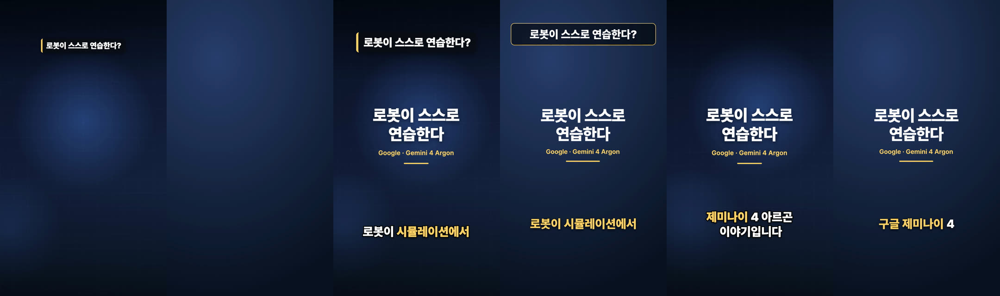
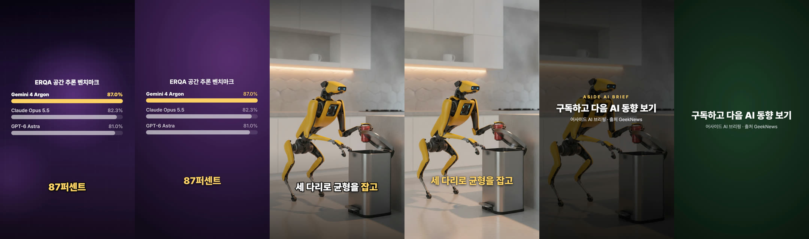
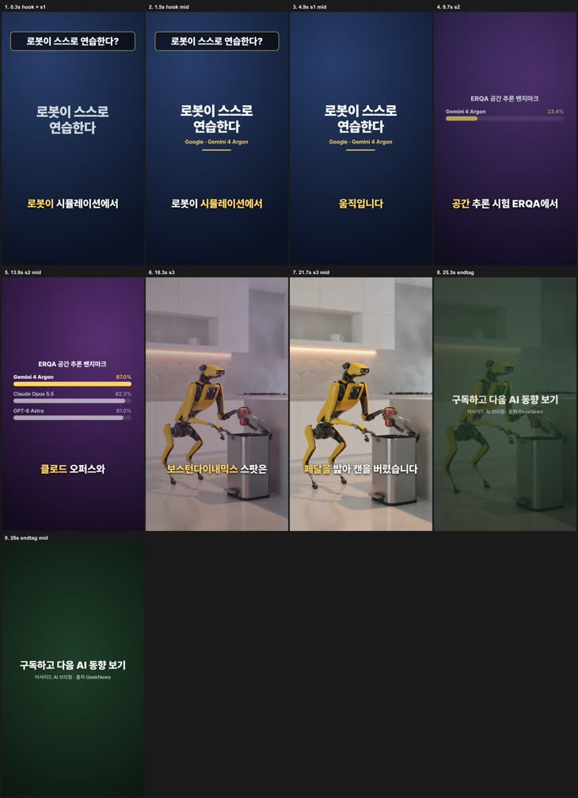

# H-0 시험 결과 — HyperFrames vs Remotion (한글 27초 쇼츠)

| 항목 | 내용 |
|---|---|
| 일자 | 2026-10-25 |
| 근거 계획 | `작업계획서_영상생성_업그레이드_HyperFrames_OpenMontage.md` 6b장 H-0 |
| 버전 | HyperFrames CLI `hyperframes@0.8.195` (텔레메트리 끔: `HYPERFRAMES_NO_TELEMETRY=1`, `DO_NOT_TRACK=1`) · Remotion 4.0.534 |
| 환경 | Apple M4 Pro · 메모리 24GB · Node 25.9.0 |
| 결론 | **통과 → H-1 착수 가능.** 렌더 속도·한글·자막 싱크·오프라인 렌더 모두 기준 안. 쇼츠 엔진은 계획대로 Remotion 유지 |

## 1. 무엇을 비교했나

「Gemini 4 Argon」 잡(`data/shorts/shorts_argon_ai_trend`)의 1~3씬 + 엔드 태그 = **27초**를 두 렌더러로 똑같이 만들었다.

- 공통 소재: 같은 edge-tts 나레이션(앞 25초로 자름), 같은 어절 자막 30토큰, 같은 BGM, 같은 이미지(3번 씬), 같은 BGM 덕킹 규칙(발화 중 0.14, 그 밖 ×2.2)
- Remotion: 기존 `ShortsScene` 에 같은 잡의 props 를 3씬으로 잘라 넣음
- HyperFrames: `gen.py`(이 폴더)가 같은 데이터로 `index.html` 하나를 생성 — H-1 의 "템플릿 + 변수" 방식 시험. 레지스트리 블록 없이 직접 작성(블록은 3장)

## 2. 결과

| 항목 | 기준 | Remotion | HyperFrames | 판정 |
|---|---|---|---|---|
| 렌더 시간 (1080×1920·30fps·27초, CRF 18) | Remotion 의 3배 이하 | 1회 18.0초 · 2회 14.1초 | 1회 38.9초(Chrome 첫 기동 포함) · 2회 19.8초 · 오프라인 19.0초 | **통과** (2회 기준 1.4배, 1회 기준 2.2배) |
| 한글 | Pretendard 정상, 어절 줄바꿈, 깨짐 0 | 정상 | 정상 — 같은 줄바꿈(「로봇이 스스로 / 연습한다」) | **통과** |
| 자막 싱크 | 어절 타이밍 그대로, ±150ms | 9.55초 「공간」, 10.10초 「추론」 강조 | 같은 프레임에서 같은 어절 강조 | **통과** (페이지를 묶는 방식만 조금 다름, 9.40초) |
| 오프라인 렌더 | 네트워크 없이 성공 | **실패** — 렌더 중 `fonts.gstatic.com`(Noto Sans KR)·jsdelivr(Pretendard) 를 받으려다 `ERR_ACCESS_DENIED` | 성공 (GSAP·Pretendard 를 `assets/` 에 두면 됨) | **HF 통과** · Remotion 쪽 문제 발견(4장) |
| 검수 도구 | 실제 문제를 1건 이상 잡나 | — | `check` 1.8초: 시스템 폰트 폴백 오류 1, 첫 프레임 빔 1, 엔드 태그 읽기 시간 부족 2 / `snapshot --review` 16.7초: 씬별·이음새별·폰 폭 시트 | **통과** — 엔드 태그 문제는 Remotion 결과에도 해당돼 U-1 린트에 반영 |
| 결과물 | 파일·음량 | 8.4MB · -20.7 LUFS · 피크 -7.4 dBFS | 5.4MB · -20.7 LUFS · 피크 -7.6 dBFS | 동등 (음량 정규화 전 값) |
| 저작 | 같은 결과를 만드는 수고 | 기존 컴포넌트 재사용 | 생성기 1개(약 200줄) 첫 작성 후 `check` 지적 2건·육안 1건(지난 어절 강조가 남음) 수정 | 무난 |

비교 프레임(왼쪽 Remotion · 오른쪽 HyperFrames, 각 쌍):




자막 싱크(위 Remotion · 아래 HyperFrames, 0 / 9.40 / 9.55 / 10.10초):


HyperFrames `snapshot --review` 폰 폭(360px) 시트:



## 3. 레지스트리 블록 (짧게 시험)

`hyperframes add data-chart`, `hyperframes add message-thread-reveal` 로 설치해 봤다.

- 편집 가능한 HTML 소스로 `compositions/` 에 복사된다(14KB, 67KB). 포함 코드 조각을 **클립보드에 자동 복사**한다(부작용 — H-1 래퍼에서는 끄거나 무시해야 함).
- `data-chart` 는 **1920×1080 가로**용, `message-thread-reveal` 은 1080×1920 세로용 — 블록마다 비율이 달라 세로 영상에는 골라 써야 한다.
- 두 블록 모두 GSAP 을 **CDN 에서**, `data-chart` 는 Google Fonts(Libre Baskerville·Franklin)까지 불러온다 → 오프라인 렌더하려면 설치 후 경로를 `assets/` 로 바꾸는 단계가 필요하다. 한글 글꼴로 바꾸는 것도 직접 해야 한다.
- 결론: 블록은 "그대로 꽂기"보다 **출발점 소스**로 쓰는 게 맞다. H-1 은 템플릿을 우리 쪽에 두고, 필요한 블록만 설치해 다듬어 커밋한다(계획 그대로).

## 4. 시험 중 발견한 것 (쇼츠 엔진)

1. **Remotion 쇼츠 렌더가 인터넷에 의존한다.** `ShortsScene.tsx` 가 Pretendard 를 jsdelivr 에서, `@remotion/google-fonts` 가 Noto Sans KR 을 gstatic 에서 렌더할 때마다 받는다. 네트워크가 막히면 렌더가 `TypeError: Failed to fetch` 로 실패하고, 엔진은 ffmpeg 폴백(단색 씬)으로 내려간다. S-6 자동 루틴 전에 폰트를 `remotion/public/` 에 두는 작은 수정이 필요하다 → 별도 수정 과제.
2. **엔드 태그를 읽을 시간이 부족하다.** 2.0초 중 페이드인 10프레임(0.33초)을 빼면 1.67초 — 마지막 줄 2초 기준 미달. HF `check` 가 잡았고, U-1 린트 규칙(`line_unread`)에 같은 계산을 넣었다(`feat/shorts-storyboard-lint`).
3. Remotion 은 0초에 훅이 이미 보여서 첫 프레임 문제는 없다(HF 쪽은 처음에 비어 있었고 고침).

## 5. H-1 에 넘길 것

- **템플릿 변수는 HF 기본 기능을 쓴다.** `data-composition-variables` + `render --variables-file` 이 있어서, `gen.py` 처럼 HTML 을 통째로 생성하지 않아도 된다. 다만 자막·덕킹 포인트처럼 개수가 바뀌는 데이터는 생성기(또는 런타임 스크립트)가 여전히 필요하다.
- 폰트·GSAP 은 프로젝트 `assets/` 에 두고 `@font-face` 로 선언(시스템 폰트를 폴백으로 쓰면 `check` 가 오류를 낸다).
- 렌더 전 `check --json`, 렌더 후 `snapshot --review` 를 QC 로 고정. 둘 다 20초 안쪽.
- CLI 는 `npx` 대신 프로젝트에 버전 고정 설치 후 로컬 바이너리로 실행(오프라인·재현성). 텔레메트리 환경변수 필수.
- 첫 템플릿은 결정 ⑧대로 `channel_trailer` + `social_card`.

## 6. 하지 않은 것 / 확인 못 한 것

- **소리는 측정만 하고 듣지 않았다.** 덕킹 자동화(`data-automation`)가 의도대로 들리는지는 사람이 들어 봐야 한다.
- Studio(타임라인 편집 화면)는 열어 보지 않았다.
- 레지스트리 블록을 실제 영상에 넣어 렌더하지는 않았다(설치·구조만 확인).
- 렌더 시간은 각 2회 측정이라 편차가 있다. 1회차는 둘 다 캐시·브라우저 기동 영향을 받는다.

## 7. 재현

```bash
export HYPERFRAMES_NO_TELEMETRY=1 DO_NOT_TRACK=1
npx -y hyperframes@0.8.195 init h0 --resolution portrait --non-interactive
# h0/assets/ 에 narration_25s.mp3 · bgm.mp3 · scene3.png · captions.json · gsap.min.js · PretendardVariable.woff2
python3 -I docs/spikes/hyperframes-h0/gen.py h0
cd h0 && npx hyperframes@0.8.195 check --json && npx hyperframes@0.8.195 render -o out.mp4 --crf 18
```

오프라인 확인은 `sandbox-exec` 로 외부 네트워크를 막고(localhost 만 허용) 같은 렌더를 돌렸다.
