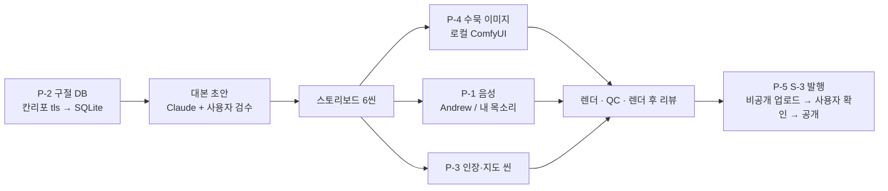

# Shiji Files 파일럿 3편 구현 작업계획서

## 1. 문서 정보

| 항목 | 내용 |
|---|---|
| 작업명 | Shiji Files 파일럿 쇼츠 3편 — 영어 음성·구절 DB·원문 인장/지도 씬·수묵 스타일·유튜브 발행 |
| 프로젝트 | `유튜브 영상분석실습` (`casareborgia/youtube-video-analysis`) |
| 작성일 | 2026-10-26 |
| 선행 | 기획서 `기획서_해외_고사채널_시즌1.md`(PR #70), 쇼츠 엔진 S-1·S-2·U-1~U-4 머지 |
| 채널 | Shiji Files(@shijifiles), `UC0o0PWB665I9q7ZTmLOcBwQ` — 앱에 OAuth 연결됨 |
| 파일럿 | #10 손무(Andrew) · #4 여불위(Andrew) · #5 한비(내 목소리) |
| 범위 밖 | 롱폼 16:9, 인스타 릴스, 자동 루틴(S-6), LLM 대본 자동 생성(파일럿 대본은 Claude 초안 + 사용자 검수) |

코드 변경은 아직 없다. 이 문서는 무엇을 어떤 순서로 만들지 정하는 계획서다.

---

## 2. 현재 엔진에서 확인한 사실 (2026-10-26)

| # | 사실 | 계획에 미치는 영향 |
|---|---|---|
| F1 | 음성 프리셋(`tts_service.EDGE_PRESETS`)은 한국어 3종뿐. 영어 판별은 `ko-KR-` 접두어 기준 | 영어 프리셋을 새로 넣어야 함 |
| F2 | **내 목소리(Qwen3) 경로가 언어를 넘기지 않는다** — `_default_synth` 가 `synthesize_speech(...)` 를 `language` 없이 불러 기본값 `korean` 으로 합성 | 고치지 않으면 #5 한비 편이 한국어 모드로 영어를 읽는다 |
| F3 | Qwen3 경로는 단어 타이밍이 없어 자막이 글자 수 비례로 나뉜다 | #5 는 자막이 약간 어긋날 수 있음 — 리뷰 시트에서 확인 |
| F4 | 쇼츠 이미지는 Gemini(유료, 일일 상한 40장) 전용. 프롬프트도 레드라인 주석 스타일. ComfyUI 경로 없음 | 수묵 스타일은 ComfyUI 생성기를 새로 붙인다(생성기 주입 지점 `generate_job_images(generator=…)` 은 이미 있음) |
| F5 | `generate_job_images` 는 어떤 생성기든 Gemini 사용량을 올린다 | ComfyUI 는 사용량에 안 잡히게 고쳐야 함 |
| F6 | 씬 종류는 image·text_card·stat_card·bar_chart·compare·flyover·scene3d | 인장(seal)·지도(map) 2종 추가 |
| F7 | `uploader.upload_video` 는 있으나 쇼츠용 발행 함수·채널 가드 없음(S-3 미착수). AI 합성 표시·언어 필드도 안 넣음 | S-3 에서 추가 |
| F8 | 로컬 LLM(qwen3.5-4b)은 빈 답 — 강조어·메타데이터 LLM 경로는 폴백만 동작 | 파일럿 강조어·제목·설명은 사람이 지정 |
| F9 | 한자를 쓸 수 있는 OFL 글꼴은 저장소의 Noto Sans KR 뿐(명조 계열 없음) | 결정 ① |

---

## 3. 전체 흐름

파일럿 한 편의 씬 구성(기획서 3장 5구간을 6씬으로):

| 씬 | 종류 | 내용 |
|---|---|---|
| 1 | image | 콜드 오픈 한 문장 |
| 2 | map | 전국시대 지도 — 나라 강조 |
| 3 | image | 배경 |
| 4 | image | 결정적 한 수 |
| 5 | seal | 원문 인장 + 자체 번역 + 출전 |
| 6 | image + 엔드 태그 | 결말 · 다음 편 예고 |

---

## 4. 단계별 작업 (요청 순서, 단계마다 PR 1개 — 머지 전 다음 단계 시작 금지)

### P-1. 영어 음성 프리셋 (`feat/shorts-english-voice`)

1. 음성 프리셋에 `edge_andrew_en`(en-US-AndrewMultilingualNeural, 속도 +0%) 추가. 영어 여부는 접두어가 아니라 프리셋의 언어 값으로 판별.
2. 잡에 `language` 값(`english`/`korean`, 기본 korean)을 두고, **내 목소리 경로에 언어를 넘긴다**(F2 수정).
3. 영어 자막 그룹핑 확인 — 문장 끝·쉼 기준은 그대로, 어절 상한 4는 영어 단어 4개로 동작하는지 테스트.
4. 끝 무음 자르기가 Andrew 에도 맞는지 측정(InJoon 기준 1.2초였음).
5. 기존 한국어 쇼츠 결과 변화 없음(회귀 테스트).
- 수용 기준: Andrew 씬 자막이 발화와 ±150ms(5단어 수동 확인) · 내 목소리 영어 씬이 영어로 합성됨(사용자 청취) · 기존 테스트 통과

### P-2. 칸리포 구절 DB (`feat/kanripo-passage-db`)

1. 받기: 史記 `KR2a0001`·戰國策 `KR2e0003`·韓非子 `KR3c0005`·孫子 `KR3b0003` 의 **`tls` 브랜치**를 얕게 내려받아 `data/kanripo/`(gitignore, 커밋 금지) — 합계 약 8MB.
2. 파싱: `# src:` 줄을 떼어 출전 번호(예: SHIJI 85.2.2)로 보관, `<pb:>`·¶·줄바꿈 제거 후 `。！？` 기준 문장 단위로 자름. 이체자는 고치지 않고 원문 그대로 둔다.
3. 저장: SQLite 한 파일(책·권·편 제목·출전 번호·문장·글자 수·사용 여부) + 에피소드↔구절 연결.
4. 검색: 키워드로 문장과 앞뒤 문맥·출전을 돌려줌. 출처 표기 문구("Original text: Kanseki Repository (Kanripo), CC BY-SA 4.0")를 출전에서 만들어 줌.
- 수용 기준: 기획서 5장의 원문 13구절(예: 此奇貨可居 → 史記 85, 斬隊長二人 → 史記 65)이 맞는 권 번호로 검색됨 · 파서 단위 테스트(마크업 섞인 줄, 문장 중간 `# src:`)

### P-3. 원문 인장·지도 씬 (`feat/shorts-seal-map-scenes`)

1. **인장(seal)**: 한자 원문(12자 이하)이 붉은 인장으로 찍히는 등장 + 영어 번역 + 출전("Shiji, ch. 85"). 비용 0.
   - 린트: 출전 없는 인장은 **P0(발행 잠금)** — 가짜 명언 금지 규칙을 코드로 강제.
   - 글꼴에 원문 한자가 모두 있는지 렌더 전에 검사(빠진 글자 = P0).
2. **지도(map)**: 전국시대 7국 개략도에서 나라 강조·화살표 동선·연도 표시. 비용 0.
   - 지도 모양은 우리가 그린 **개략도**(공개 지도 이미지 복사 안 함), 화면에 "approximate" 표기. → 결정 ②
3. 두 종류 모두 ffmpeg 폴백에서는 글자 카드로 대체, 씬 카드 UI 에서 편집 가능.
- 수용 기준: 두 씬 단독 렌더 · 인장 출전 누락 시 발행 잠금 · 폰 360px 확인 시트에서 글자 판독 가능

### P-4. 수묵 시네마틱 스타일 (`feat/shorts-ink-style`)

1. ComfyUI 생성기(로컬 z-image-turbo 워크플로, 720×1280, 장당 약 90초)를 기존 생성기 자리에 끼울 수 있게 추가. ComfyUI 가 꺼져 있으면 **분명한 오류로 멈춤 — Gemini 로 자동 전환하지 않음**(과금 방지).
2. 스타일 문구 고정: 배너와 같은 수묵 계열(어두운 먹색, 금빛 조명, 옅은 붉은 하늘) + "글자·문자 없음".
3. ComfyUI 생성분은 Gemini 사용량에 넣지 않음(F5 수정).
4. 화면 톤 묶음 `shiji_ink`: 금색·인장 붉은색 강조, 예능 룩(Jua 글꼴·통통 튀는 효과) 미사용, 전환은 dip·zoom_through 위주.
5. AI 이미지에 가짜 한자가 섞일 수 있으므로 렌더 후 리뷰 시트에 "이미지 속 글자 확인" 항목 추가(사람 확인).
- 수용 기준: 6씬 이미지 생성 비용 0 · 색감이 배너와 같은 계열(사용자 확인) · Gemini 사용량 변화 없음

### P-5. S-3 유튜브 발행 — 파일럿 범위 (`feat/shorts-publish-youtube`)

1. 발행 함수: 채널 ID 필수, 기본값 `SHORTS_YOUTUBE_CHANNEL_ID`(.env, Shiji Files), **루나 채널이면 거부**, `publish_allowed` 통과 필수.
2. 메타데이터: 제목은 사람이 지정, 설명은 템플릿(훅 한 줄 + "📜 Source: Shiji, ch. N" + 칸리포 출처 + 해시태그). 카테고리 27(교육), 언어 en.
3. **AI 합성 표시**를 업로드 때 켬, 아동용 아님.
4. 항상 **비공개로 먼저** 올리고, 사용자가 Studio 에서 확인한 뒤 공개(앱에서 공개 전환 버튼 또는 Studio).
5. 할당량: 업로드 1편당 약 1,600 유닛 — 하루 3편 이내.
6. 인스타 export 번들·LLM 메타데이터는 이번 범위에서 뺌(기존 S-3 계획의 나머지는 다음 단계).
- 수용 기준: 실제 1편 비공개 업로드 → Studio 에서 쇼츠로 분류 확인 · 루나 채널 지정 시 거부 테스트 · 발행 잠금 상태 업로드 거부 테스트

### P-6. 파일럿 제작 (코드 아님)

| 순서 | 할 일 | 누가 |
|---|---|---|
| 1 | 구절 DB 에서 세 편의 원문·출전 확정 | Claude → 사용자 확인 |
| 2 | 영어 대본 초안(씬마다 한 문장, 60초 이내) | Claude → **사용자 검수** |
| 3 | 스토리보드·이미지·음성·렌더 | 엔진 |
| 4 | 렌더 후 리뷰 시트 확인(자막·이미지 속 글자·인장) | 사용자 |
| 5 | 비공개 업로드 → 확인 → 공개(월·수·금) | 엔진 + 사용자 |

---

## 5. 순서와 예상 규모

| 단계 | 규모 | 주로 바뀌는 곳 |
|---|---|---|
| P-1 | 작음 | 음성 프리셋, 쇼츠 합성 경로 |
| P-2 | 중간 | 새 모듈(구절 DB) + 수집 스크립트 |
| P-3 | 큼 | Remotion 씬 2종, 엔진 씬 종류·린트 |
| P-4 | 중간 | ComfyUI 생성기, 사용량 집계, 톤 묶음 |
| P-5 | 중간 | 발행 함수, 업로더 필드, API·UI |

다섯 단계 모두 `shorts_engine.py` 를 건드려서 동시에 진행하지 않는다(같은 파일 충돌). 요청하신 순서 그대로 하나씩 머지한다.

---

## 6. 사용자 결정 — 2026-10-26 확정(권장안대로)

| # | 결정 | 확정 |
|---|---|---|
| ① | 인장 한자 글꼴 | **Noto Serif TC(OFL) 내려받기** — 사용자 허락 받음(2026-10-26). P-3 에서 내려받아 OFL 고지와 함께 `remotion/public/fonts` 에 둠 |
| ② | 지도 | 직접 그린 개략도 + "approximate" 표기 |
| ③ | 공개 방식 | 비공개 업로드 → 사용자 확인 → 공개 |
| ④ | 발행 요일 | 월(#10 손무)·수(#4 여불위)·금(#5 한비) |

## 7. 금지 사항

- 칸리포 원본·DB 파일 커밋 금지(`data/kanripo/` gitignore)
- ComfyUI 실패 시 Gemini 자동 전환 금지
- 출전 없는 원문 인용 발행 금지(린트 P0)
- 루나 채널로 쇼츠 발행 금지
- OpenMontage 코드 복사 금지(AGPL)
