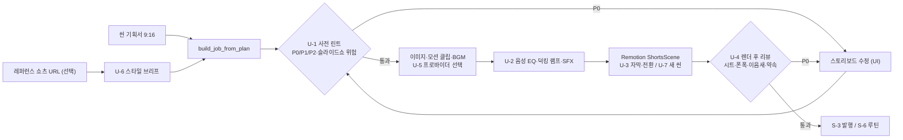

# 영상 생성 시스템 업그레이드 작업계획서 — HyperFrames · OpenMontage 2차 반영

## 1. 문서 정보

| 항목 | 내용 |
|---|---|
| 작업명 | 쇼츠 영상 생성 엔진(`shorts_engine` + `remotion/ShortsScene`) 품질·자동화 업그레이드 |
| 프로젝트 | `유튜브 영상분석실습` (`casareborgia/youtube-video-analysis`) |
| 작성일 | 2026-10-25 |
| 참고 레포 | [heygen-com/hyperframes](https://github.com/heygen-com/hyperframes) `32d2d3c` (2026-10-25) · [calesthio/OpenMontage](https://github.com/calesthio/OpenMontage) `e01dbf4` (2026-10-23) |
| 선행 문서 | `작업계획서_쇼츠_자동화_Shorts_Reels.md` (10/19, 같은 레포를 10/16~18 시점으로 1차 검토) |
| 현재 상태 | S-1·씬 종류(#42)·S-2(#44)·Remotion 갤러리(#55)·음량(#56)·flyover(#60)·scene3d(#61) 머지. 남은 1차 경로: S-3 발행 → S-6 자동 루틴 |
| 범위 밖 | 롱폼 16:9 `producer.py` 개편, 인스타 릴스(S-4), 실사 토킹헤드, 유료 영상 생성(Veo·Kling 등) |

이 문서는 두 레포를 **오늘 다시 클론해 1차 검토 이후 바뀐 부분**을 읽고, 이미 반영한 것과 아직 없는 것을 대조한 계획서다. 코드 변경은 아직 없다.

---

## 2. 1차 검토 이후 레포에서 달라진 점

### 2.1 HyperFrames — 스킬이 21개에서 7개로 합쳐지고, "검수 도구"가 생겼다

- 스킬 구조 개편: `music-to-video`·`faceless-explainer` 등이 사라지고 `/hyperframes`(계약·참조) · `/hyperframes-cli` · `/hyperframes-registry` · `/media-use` 4개 코어로 통합. 1차 계획서 S-5가 가리키던 `music-to-video/scripts/analyze-beatgrid.py`는 이제 CLI `hyperframes beats`(`@hyperframes/core/beats`)로 옮겨졌다.
- **레지스트리 약 450개**(blocks 210 + components 239): 전환 13계열, 차트(bar-chart-race·line-graph·heatmap), 지도, 메시지·알림 리빌, 코드 타이핑, 키네틱 타이포, 셰이더 배경 등. HTML/GSAP 소스라 그대로는 못 쓰지만 **0원 씬 종류의 설계 카탈로그**로 쓸 수 있다.
- **검수(review) 체계**가 새로 생겼다(`references/review.md`, `check`·`snapshot --review` 명령):
  - 측정 경고: `line_unread`(읽기 시간 부족), `dead_stretch`(3초 넘게 변화 없음), `text_below_floor`(짧은 변의 2.6% 미만 글자), `first_frame_empty`(썸네일이 되는 첫 프레임이 빔), `film_silent`, `text_occluded`, `canvas_overflow` 등
  - 콘택트 시트 3장: 씬 시작·중간 / 컷 전후 ±0.2초 / **폰 폭 360px**
  - 지적 형식 `t=4.2s · 위치 · 문제 → 정확한 수정 · 유지할 것`, 등급 P0/P1/P2, "10점 만점 점수는 매기지 않는다"
- **사운드 규칙**(`references/sound.md`, `media-use/references/mixing.md`): 음성 아래 BGM 덕킹(발화 중 0.3~0.4배), 음성 대역만 파내는 `carve`, 효과음은 **화면에 원인이 있을 때만**·같은 소리 2~3개 교대·피크는 그림보다 1프레임 뒤·베드보다 3~6dB 위, 강한 마디에서 BGM 진입.
- **자막 규칙**(`references/captions.md`): 에너지별 그룹 크기(2~3 / 3~5 / 4~6단어), 문장 끝·150ms 이상 쉼에서 끊기, 0초에 바로 띄우지 않기(0.1~0.3초 뒤), 그룹마다 강제 종료, 세로 화면 최대 폭 900·최소 42px, Whisper 무음 환각 제거.
- **"생성된 티" 금지 목록**(`story.md` §8, `motion.md`): 모든 씬이 같은 방식으로 등장, 모든 요소가 페이드+슬라이드업, 착지한 제목이 계속 움직임, 숨 쉬는 루프, 카드 3개 나열. 전환은 **원인이 있는 3~5종**, 하드컷은 이음새의 1/3 이하.
- 라이선스 Apache-2.0 그대로. 작은 로직 이식은 가능(출처 표기), 런타임 도입 판단은 4장.

### 2.2 OpenMontage — "슬라이드쇼처럼 보이는가"를 미리 재는 도구들

- 라이선스 **AGPL-3.0** 그대로 → 코드 복사 금지, 규칙·수치만 재작성(1차 결정 유지).
- 새로 확인한 자산:

| 원천 | 내용 | 우리 시스템에 주는 의미 |
|---|---|---|
| `lib/slideshow_risk.py` | 기획 단계에서 6개 축(반복·장식적 비주얼·목적 없는 모션·샷 의도 부족·**타이포 과의존**·근거 없는 시네마틱)을 0~5점으로 매겨 4.0 이상이면 합성 단계 진입 금지 | 우리 쇼츠는 카드형 씬이 대부분이다. 「Gemini 4 Argon」 0원 버전(텍스트 2·막대 1·숫자 1·비교 2)은 **글자 카드 비율 100%**, 이미지 1장을 넣은 현재 v3 도 83% → 가장 먼저 잡아야 할 약점 |
| `lib/variation_checker.py` | 씬 기획의 반복 패턴·뻔한 문구("혁신적", "놀라운" 류) 탐지 | 로컬 LLM 기획서의 상투어 필터 |
| `lib/delivery_promise.py` | 제작 약속(모션 중심·데이터 설명 등)을 기획 시 잠그고, 합성 단계가 못 지키면 **조용히 낮추지 말고 멈춰서 묻기** | 지금 ffmpeg 폴백은 비이미지 씬을 단색으로 바꾸고 경고만 남긴다 → 차단 대상 |
| `tools/analysis/audio_energy.py` | ebur128 순간 음량으로 곡의 "재미있어지는 지점"을 찾아 재생 오프셋 추천 | BGM이 조용한 인트로부터 시작하는 문제 해결 |
| `skills/creative/sound-design.md` | 덕킹 6~12dB(어려운 설명은 최대 22dB), 배경음 2~4kHz 컷, 효과음 종류별 길이·레벨, 휙 소리는 전환 10~20ms 앞 | 오디오 2.0 수치 근거 |
| `skills/meta/video-reference-analyst.md` | 레퍼런스 영상을 **5측면**(피사체·피사체 움직임·장면/오버레이·프레이밍·카메라)과 씬별 `motion_type`(모션 클립/움직이는 스틸/정지)으로 분해 → 제작 경로 결정 | 이 프로젝트 본업(유튜브 영상 분석)과 직결. 잘 되는 쇼츠의 구조를 브리프로 뽑아 생성에 반영 |
| `tools/_comfyui/workflows/` | `wan22-i2v-4step`(이미지→영상), `wan22-t2v-4step`, `ace-step-1-t2a`(음악 생성), `flux2-txt2img` | 이미 쓰는 로컬 ComfyUI(z-image-turbo)로 **0원 히어로 모션 클립·0원 BGM** 가능성 |
| `tools/analysis/visual_qa.py`·`composition_validator.py` | 렌더 전 props 검증(누락 자산·나레이션>영상), 렌더 후 프레임 추출 검사 | QC 확장 |

---

## 3. 현재 시스템 대조 — 이미 있는 것 / 빠진 것

| 영역 | 이미 있는 것 (코드 위치) | 빠진 것 → 이 계획의 단계 |
|---|---|---|
| 기획 검수 | 60초 컷 `fit_to_max_seconds`, 씬 수 상한 6 | 슬라이드쇼 위험·읽기 시간·반복·상투어 **사전 린트** 없음 → **U-1** |
| 오디오 | -18 LUFS, BGM 나레이션보다 22 LU 아래, 끝 무음 자르기, BGM 덕킹(`ShortsScene.tsx:704`, 발화 ±250ms에서 계단식 2.2배) | 덕킹이 계단식(램프 없음), BGM이 곡 처음부터 재생, 음성 EQ 없음, 효과음은 전환 whoosh 1종 고정(`:801`, 기본 꺼짐) → **U-2** |
| 자막 | edge-tts 어절 타이밍, `createTikTokStyleCaptions` 1.2초 창 페이징, `fitTextOnNLines` | 문장 끝·쉼 기준 그룹핑 없음, 강조어 없음, 0초 시작 방지 없음 → **U-3** |
| 전환·등장 | fade/slide/wipe/none (`ShortsScene.tsx:629`) | 원인 있는 전환(줌스루·색 범람·휩·딥컷) 없음, 반복 방지 자동 배정 없음 → **U-3** |
| 렌더 후 QC | 길이·해상도·오디오 유무·첫 프레임 밝기·LUFS (`qc_job`) | 콘택트 시트·폰 폭 가독성·전환 이음새 검사·지적 리포트 없음, 폴백 다운그레이드가 통과됨 → **U-4** |
| 생성 프로바이더 | Gemini 이미지(과금 가드), ComfyUI 이미지는 1회 수동 사용 | ComfyUI 정식 클라이언트·모션 클립·BGM 생성·프로바이더 선택·비용 장부 없음 → **U-5** |
| 레퍼런스 활용 | `analyze.py` 는 자막 기반 분석만 | 시각 구조(컷 수·샷 길이·모션 유형·훅 기법) 분석 → 스타일 브리프 → 컨셉 팩 연결 없음 → **U-6** |
| 0원 씬 종류 | image·text_card·stat_card·bar_chart·compare·flyover·scene3d | 키네틱 타이포·메시지 리빌·추세선 등 "카드가 아닌" 0원 비주얼 부족 → **U-7** |

---

## 4. 아키텍처 결정

1. **쇼츠 엔진의 컴포지터는 계속 Remotion 하나, HyperFrames 는 별도 용도로 시험 후 도입.** 쇼츠 엔진은 Remotion 4.0.534 위에 7종 씬·3D·전환·자막이 이미 테스트와 함께 있고, 한 엔진에 렌더러를 둘 두면 props·폰트·QC가 두 벌이 된다. 그래서 쇼츠 엔진에는 HyperFrames 의 **규칙과 수치만 Python/TSX로 재작성**해 넣는다(U-1~U-4). 반면 트레일러·인트로·소셜 카드·롱폼 그래픽처럼 **쇼츠 밖 용도**에는 HyperFrames 를 별도 파이프라인으로 쓴다 — H-0 시험(렌더 속도·한글·오프라인)을 통과하면 H-1 로 붙인다(6b장, 결정 ⑤·⑧).
2. **검수는 2단계 게이트.** 렌더 전 `lint_storyboard`(0원, 수 ms) → 렌더 후 `review_render`(ffmpeg 시트, 0원) → 선택적 비전 리뷰(유료/로컬). P0가 하나라도 있으면 상태 `needs_review`, 발행 버튼 잠금.
3. **새 모듈 하나로 묶는다.** `shorts_review.py`(린트·시트·리포트)를 새로 만들고 `shorts_engine.build_job` 이 호출한다. `shorts_engine.py`(1,477줄)에 더 쌓지 않는다.
4. **사용자가 정한 값은 기본값으로 유지.** -18 LUFS, BGM 22 LU 아래, edge-tts 기본, 이미지 편당 7·일 40장. U-2의 새 파라미터(발화 밖 BGM 레벨 등)는 **A/B 샘플을 들려 드리고 고른 값**으로 확정한다(10/25 음량 결정과 같은 방식).
5. **라이선스**: HyperFrames(Apache-2.0)에서 옮긴 수치·로직은 파일 상단 주석에 출처 표기. OpenMontage(AGPL-3.0)는 문서의 규칙만 참고해 새로 작성, 코드 블록 복사 0.
6. **약속 잠금(delivery promise)**: 잡에 `promise`(`data_explainer`·`motion_led`·`music`) 필드를 두고, 렌더러 폴백·이미지 누락 대체가 약속을 깨면 조용히 넘어가지 않고 P0로 올린다.

### 업그레이드 후 파이프라인

---

## 5. 착수 순서

| 순서 | 단계 | 브랜치 | 비용 | 의존 |
|---|---|---|---|---|
| 1 | **U-1** 사전 품질 린트 + 슬라이드쇼 위험 점수 | `feat/shorts-storyboard-lint` | 0 | 없음 |
| 2 | **U-2** 오디오 2.0 (덕킹 램프·BGM 진입점·음성 EQ·효과음 팔레트) | `feat/shorts-audio-v2` | 0 | 없음 (U-1과 병행 가능) |
| 3 | **U-3** 자막 그룹핑·강조어 + 원인 있는 전환·반복 방지 | `feat/shorts-captions-transitions-v2` | 0 | U-1 (반복 규칙 공유) |
| 4 | S-3 유튜브 발행 + export 번들 (기존 계획) | `feat/shorts-publish-youtube` | 할당량 | — |
| 5 | **U-4** 렌더 후 리뷰 (콘택트 시트·폰 폭·이음새·약속 검사) | `feat/shorts-render-review` | 0 (비전 리뷰는 결정 ②) | U-1 |
| 6 | S-6 자동 루틴 (기존 계획, U-1·U-4 게이트를 통과한 편만 큐 등록) | `feat/shorts-autopilot` | 이미지+할당량 | S-3, U-4 |
| 7 | **U-5** ComfyUI 로컬 프로바이더 (스파이크 → 구현) | `spike/comfyui-wan-acestep` → `feat/shorts-local-providers` | 0 (전기·시간) | 없음 |
| 8 | **U-7** 0원 씬 종류 3개 추가 | `feat/shorts-scene-kinds-v2` | 0 | U-1 (타이포 비율 계산에 새 종류 반영) |
| 9 | **U-6** 레퍼런스 쇼츠 분석 → 스타일 브리프 | `feat/shorts-reference-brief` | 비전 모델 호출 소액 | U-1 |
| 별도 | **H-0** HyperFrames 시험 (쇼츠 엔진과 무관, 언제든 병행 가능) | `spike/hyperframes-h0` (보고서만 병합) | 0 | 없음 |
| 별도 | **H-1** HyperFrames 별도 용도 파이프라인 | `feat/hyperframes-pipeline` | 0 | H-0 통과, 결정 ⑧ |

권장 이유: 새 채널에 처음 올라가는 영상부터 품질이 중요하므로 **U-1~U-3(0원, 편당 품질)을 S-3 앞에** 둔다. U-4는 S-6 자동화의 안전장치라 S-6 직전. U-5~U-7은 소재 다양화라 자동화가 돈 뒤에 해도 된다. 각 단계 PR 1개, 머지 전 다음 단계 착수 금지(기존 규칙). U-1과 U-2는 파일이 겹치지 않아 동시에 진행할 수 있다.

**H-트랙**은 쇼츠 엔진 파일(`shorts_engine.py`, `remotion/`)을 건드리지 않으므로 U-단계와 파일이 겹치지 않는다. 그래서 위 "머지 전 다음 단계 착수 금지" 규칙의 예외로, U-단계와 병행해도 된다. 권장 시점은 U-1 착수와 동시에 H-0(반나절 분량).

---

## 6. 단계별 작업

### U-1. 사전 품질 린트 (`feat/shorts-storyboard-lint`)

1. `shorts_review.py` 신규 — `lint_storyboard(job) -> {"findings": [...], "risk": {...}}`. 각 지적은 `{"level": "P0|P1|P2", "code", "scene", "t", "message", "fix"}` (HyperFrames 형식 `t · 위치 · 문제 → 수정` 을 필드로).
2. 규칙(한국어로 조정한 수치):

| 코드 | 판정 | 등급 | 근거 |
|---|---|---|---|
| `line_unread` | 화면 문구 노출 시간 < 0.5초 + 어절당 0.3초, 마지막 줄(엔드 태그)은 페이드인 0.33초를 뺀 뒤 < 2초 | P0 | HF story.md §6 |
| `first_frame_empty` | 0초 프레임에 훅 문구도 비주얼도 없음 | P0 | HF review |
| `text_overflow` | 훅 > 30자(배너 2줄), text_card 제목 > 42자(3줄) — 최소 글자 크기에서 넘침 | P1 | HF check `text_box_overflow` (구현 시 변경: ShortsScene 은 글자를 34px 아래로 줄이지 않아 28px 하한 규칙은 걸릴 수 없음) |
| `dead_stretch` | 카드형 씬에서 등장 애니메이션·자막 페이지 변화 사이가 3초 넘게 빔. 빌드 전(자막 없음)에는 나레이션 없는 씬만 판정 | P1 | HF check |
| `typography_overreliance` | 글자 중심 씬(text_card·stat_card·compare·bar_chart) 비율 > 60% P1, 100% P0 | P0/P1 | OM slideshow_risk |
| `repetition` | 같은 kind 연속 3회, 같은 전환 연속 2회, 같은 팔레트 전 씬 | P1 | OM slideshow_risk·variation_checker |
| `screen_repeats_voice` | 화면 문구가 나레이션 문장과 80% 이상 같음 | P1 | HF story.md §6 |
| `generic_phrase` | 상투어 목록("혁신적", "놀라운", "게임체인저", "완벽한", "단 몇 초 만에" 등, `shorts_review.GENERIC_PHRASES`) | P2 | OM variation_checker, HF banned words |
| `caption_at_zero` | 첫 자막이 0초에 시작 | P2 | HF captions |

3. 슬라이드쇼 위험 점수: 반복·타이포 과의존·모션 목적(같은 `motion` 반복)·훅 강도 4축 0~5점 평균. 4.0 이상이면 빌드 버튼에 경고 + 확인 모달(차단은 아님, 결정 ⑦).
4. `build_job` 시작 시 린트 실행 → `job["lint"]` 저장. `GET /api/shorts/jobs/{id}/lint`, 스토리보드 수정(`update_storyboard`) 후 자동 재실행.
5. UI: 쇼츠 패널 스토리보드 카드 옆에 P0/P1/P2 배지, 지적 클릭 시 해당 씬으로 이동.
6. 테스트 `tests/test_shorts_review.py`: 규칙별 경계값(0.5초+어절 수, 28px, 60%/100%), Argon v3 6씬 → `typography_overreliance` P1(83%)·글자 카드만이면 P0, 반복 패턴, 상투어.
7. 수용 기준
   - [x] 기존 잡 `shorts_argon_ai_trend` 린트: P0 1(엔드 태그) · P1 2(글자 카드 83%·전환 전부 fade) · P2 1(0초 자막), 위험 2.2 acceptable
     (1차 계획서의 "6씬 모두 글자 카드"는 0원 버전 기준이었고, 현재 v3 는 3번 씬이 이미지라 100% → 83%, P0 아닌 P1)
   - [x] 린트가 기존 빌드 흐름을 막지 않음(경고만, 위험 4.0 이상만 `confirm_lint` 확인)

### U-2. 오디오 2.0 (`feat/shorts-audio-v2`)

1. **덕킹 램프**: `bgmVolumeAt` 의 계단식 전환을 어택 120ms·릴리즈 300ms 보간으로 교체(Remotion `interpolate`). 발화 밖 레벨 배율(현재 2.2배, 최대 0.5)은 A/B로 확정(결정 ④).
2. **BGM 진입점**: `shorts_engine.bgm_entry_offset(path, duration)` — ffmpeg `ebur128` 순간 음량(100ms)으로 곡에서 영상 길이만큼 에너지가 높은 구간의 시작을 찾는다(OM `audio_energy` 개념 재작성). props `bgmStartFrom` 로 전달, 끝은 1초 페이드(기존 유지).
3. **음성 EQ 체인**: edge-tts 결과에 ffmpeg `highpass=f=80, equalizer=f=3000:g=2.5, alimiter=limit=-1dB`. `SHORTS_VOICE_EQ=1` 기본, 끄기 가능. 루나·베가 경로는 손대지 않음.
4. **BGM 음성 대역 비우기**: BGM에 2~4kHz 대역 -3dB(`equalizer=f=3000:width_type=o:w=1:g=-3`). HF `carve` 의 단순판.
5. **효과음 팔레트** (`sfx` 옵션 확장, 기본 꺼짐 유지):
   - 전환: `whoosh`·`whip` 교대(같은 소리 연속 금지), 피크가 전환 최대 변화 시점 1프레임 뒤에 오도록 오프셋
   - 숫자 착지(stat_card 카운트 종료): `uiSwitch` 1회
   - 그 외 소리는 넣지 않는다(HF: 원인 없는 효과음·차임 금지). 리저/임팩트는 무료 CC0 에셋 확보 시에만(결정 ⑥)
   - 레벨: 베드보다 3~6dB 위, 씬당 최대 1개
6. 테스트: 진입점 탐색(합성 신호: 조용 10초 + 큰 소리 구간), 램프 값, EQ 필터 문자열, 효과음 배치(연속 동일 금지).
7. 수용 기준
   - [x] A/B 샘플(기존 엔진 · 배율 1.6 · 2.2 · 3.0, Argon 53초) 렌더 → 사용자 청취 후 **2.2 확정**(2026-10-25). 배율 차이는 엔드 태그 구간에서 주로 들림(씬 사이 0.35초 패드는 덕킹 여유 ±0.25초에 묻혀 나레이션 내내 낮게 유지)
   - [x] 최종 -18 LUFS ±1, 피크 ≤ -1 dBTP 유지 (샘플 4개 모두 -18.0, 피크 -3.7~-5.4 dBTP)
   - 구현 메모: 효과음은 `@remotion/sfx` 원격 URL(remotion.media) 대신 `remotion/public/sfx/`(CC0, `CREDITS.md`)에 두어 오프라인 렌더 대상에 포함. Argon 곡 진입점 14.2초

### U-3. 자막·전환 2.0 (`feat/shorts-captions-transitions-v2`)

1. **자막 그룹핑** `group_captions(words, energy)`: 1.2초 고정 창 대신 문장 끝·150ms 이상 쉼·어절 수 상한(에너지 `high` 2~3, `normal` 3~4, `calm` 4~5)에서 끊는다. 결과를 `pageBreakAfter` 로 Remotion에 전달. 첫 그룹은 0.15초 이후 시작, 그룹마다 0.12초 페이드 후 강제 숨김.
2. **강조어**: 씬 대본에서 로컬 LLM이 고른 핵심어 1개(숫자·고유명사 우선)를 액센트 색 + 1.1배로 표시. LLM 실패 시 숫자 토큰 → 없으면 강조 없음.
3. **원인 있는 전환** 4종을 Remotion 커스텀 presentation으로 추가: `zoom_through`(다음 씬으로 줌 인 블러), `color_flood`(배경색이 다음 팔레트로 범람), `whip`(0.2초 가로 번짐 + 착지 선명화), `dip`(3프레임 40% 어두워진 뒤 컷).
4. **자동 배정** `assign_transitions(job)`: 사용자가 지정하지 않은 이음새에 3~5종을 배정, 같은 전환 연속 금지, 하드컷 ≤ 1/3, 같은 kind 사이에는 `color_flood`/`dip` 우선. 씬 종류별 등장 방식도 2종 이상으로 나눠 "전부 페이드+슬라이드업"을 피한다.
5. 테스트: 그룹핑(마침표·쉼·상한), 강조어 폴백, 배정 규칙(연속 금지·비율), Remotion 렌더 스모크(전환 4종 각 1회).
6. 수용 기준
   - [x] 기존 잡(Argon) 재렌더 시 U-1 `repetition`·`caption_at_zero` 지적 0 (자동 배정: slide·zoom_through·whip·wipe·color_flood)
   - [x] 자막이 문장 중간에서 끊기지 않음 — Argon 17그룹, 그룹당 2~5어절, 문장·쉼 경계에서 끊김(프레임 확인)
   - 구현 메모: 그룹핑·강조어는 `shorts_captions.py`(엔진·린트 공용). 저장된 자막은 그대로 두고 렌더 props 에서만 그룹 경계를 단다(이전 잡도 재렌더만으로 적용). 첫 그룹은 0.15초 뒤, 그룹은 마지막 어절 + 0.3초와 다음 그룹 시작 중 이른 쪽에서 지움. 전환별 길이(휩 0.25·딥컷 0.14·줌스루 0.45·색 범람 0.5초). 등장 방식은 text_card·stat_card 를 씬 순서로 2가지 번갈아. 강조어는 씬 카드에서 고칠 수 있고, 바꾼 경우에만 저장. 린트 `dead_stretch` 는 강조 어절이 옮겨 가는 것도 변화로 셈

### U-4. 렌더 후 리뷰 (`feat/shorts-render-review`)

1. `shorts_review.review_render(job)` — ffmpeg만 사용:
   - `review_scenes.jpg`: 씬별 시작+0.3초·중간 프레임 타일
   - `review_seams.jpg`: 각 이음새 −0.2초/+0.2초 쌍
   - `review_phone.jpg`: 주요 프레임을 360px 폭으로 축소(폰 가독성 확인)
   - 이음새 프레임 유사도(급격한 점프), 0초 프레임 밝기(기존), 오디오 존재·LUFS(기존)
2. **약속 검사**: `promise` 가 `motion_led`/`data_explainer` 인데 렌더러가 ffmpeg 폴백이었거나 이미지·3D 씬이 단색으로 대체됐으면 P0 `promise_downgraded`.
3. **비전 리뷰(선택, 결정 ②)**: 시트 3장 + 스토리보드를 비전 모델에 주고 P0/P1 지적만 받는다(점수 금지). 결과는 `review.json` + 짧은 `REVIEW.md`(내린 판단·측정한 것/안 한 것·가장 약한 씬).
4. 상태: P0 있으면 `needs_review`, S-3 발행 API가 거부. UI에 시트 3장과 지적 목록, `[그래도 진행]`(사유 입력) 버튼.
5. 테스트: 시트 생성(짧은 합성 영상), 이음새 점프 검출, 폴백 다운그레이드 P0, 발행 잠금.
6. 수용 기준
   - [x] 기존 잡(Argon 53초) 시트 3장 + 검사 3.98초
   - [x] ffmpeg 렌더 시 QC 는 통과해도 리뷰 P0 `promise_downgraded` → `needs_review`, `publish_allowed` 거부
   - 구현 메모: 전환 튐은 "이웃 프레임 밝기 차 > 40 이면서 그 한 프레임이 전환 구간 변화량의 35% 이상"(Argon 실측 정상 0.12~0.17). 이 검사로 U-3 휩 전환의 결함(들어오는 씬이 첫 프레임에 화면 65% 를 덮음, 0.42)을 찾아 화면 전체를 밀어내는 방식으로 고침. 검은 화면(평균 밝기 < 12) P1. 비전 리뷰는 결정 ② 대로 하지 않음. "그래도 진행"은 사유 5자 이상, 리뷰를 다시 돌리면 기록을 지움. S-3 발행은 `shorts_engine.publish_allowed(job)` 를 써야 함

### U-5. ComfyUI 로컬 프로바이더 (스파이크 → `feat/shorts-local-providers`)

1. **스파이크(코드 미병합)**: 이 Mac에서 ComfyUI로 ① Wan 2.2 i2v 4-step(720×1280, 3~5초) ② ACE-Step 30~60초 BGM을 각 1회 생성해 **소요 시간·메모리·품질**을 기록. 기준: 클립 1개 10분 이하·쇼츠 1편 총 30분 이하면 진행, 아니면 BGM만 진행하거나 보류.
2. 구현(스파이크 통과 시): `comfy_client.py` 신규(REST `/prompt`·`/history`·`/view`, 타임아웃 후 `prompt_id` 로 재개 — OM 클라이언트의 동작을 참고해 새로 작성), 워크플로 JSON은 `data/comfy_workflows/` 에 두고 모델 경로는 `.env`.
3. 새 씬 종류 `video`(히어로 모션 클립, 편당 최대 1개) + 기존 `image` 의 `provider: gemini|comfyui|none`. 선택 규칙: 예산 0이면 comfyui → 실패 시 0원 씬으로 대체(약속 검사 연동).
4. BGM 원천에 `acestep` 추가(루나 트랙 의존 해소, 루나 채널 음원과 섞이지 않게 저장 위치 분리).
5. 비용 장부: `shorts_usage.json` 에 프로바이더별 장수·초·소요 시간 기록, UI 요약.
6. 수용 기준: 히어로 클립 1개 + 0원 씬 5개로 쇼츠 1편 완성, 외부 과금 0.

### U-6. 레퍼런스 쇼츠 분석 → 스타일 브리프 (`feat/shorts-reference-brief`)

1. 입력: 유튜브 쇼츠 URL(기존 분석 흐름의 다운로드 재사용). ffmpeg `scdet` 로 컷 시각 → 컷 수·평균 샷 길이, 1fps 키프레임 시트, 프레임 차분으로 씬별 `motion_type`(모션 클립/움직이는 스틸/정지).
2. 비전 모델로 5측면(피사체·움직임·장면/오버레이·프레이밍·카메라) + 훅 기법(첫 2초 문구·장면) + 자막 스타일 + 팔레트 추출 → `style_brief.json`. 측면이 없으면 `N/A` 명시(OM 규칙).
3. 브리프 → 컨셉 팩 파라미터(씬 길이·씬 종류 비율·팔레트·자막 에너지·훅 패턴)로 변환해 `build_job_from_plan(style_brief=...)` 에 반영.
4. 저작권: 구조·수치만 사용, 레퍼런스의 영상·이미지·문구는 저장·재사용하지 않음(분석 후 원본 삭제).
5. 수용 기준: 레퍼런스 1편 → 브리프 → 같은 구조(컷 리듬·훅 방식)의 쇼츠 1편, 사용자 비교 확인.

### U-7. 0원 씬 종류 3개 (`feat/shorts-scene-kinds-v2`)

HF 레지스트리를 카탈로그로 삼아 Remotion TSX로 새로 작성(코드 이식 아님).

| `kind` | 그리는 것 | 쓰임 | 참고 블록 |
|---|---|---|---|
| `kinetic_type` | 어절이 박자에 맞춰 크기·위치를 바꾸며 등장, 착지 후 정지 | 훅·결론 | `hw-title`, `glass-shard-title` |
| `chat_thread` | 메시지/AI 답변 말풍선이 순서대로 리빌 | AI 뉴스·대화 인용 | `message-thread-reveal`, `chatgpt-exchange` |
| `line_chart` | 추세선이 그려지며 끝점 값 카운트 | 변화·추세 | `mk-line-graph`, `data-chart` |

각 종류: `fill_kind_defaults`, U-1 타이포 비율 분류(kinetic_type 은 글자 중심, 나머지는 비주얼로 계산), ffmpeg 폴백 경고, 테스트·렌더 스모크.

---

## 6b. H-트랙 — HyperFrames 를 쇼츠 밖 용도로

**왜 따로 두나.** 쇼츠 엔진은 Remotion 위에 이미 완성돼 있어 렌더러를 바꾸거나 둘을 섞지 않는다(4장 1번). 하지만 HyperFrames 는 그와 별개로 장점이 분명하다.

| 장점 | 내용 |
|---|---|
| 라이선스 | Apache-2.0, 회사 규모 무관 무료. Remotion 은 개인·3인 이하 무료이고 5.0 에서 조건 변경 예고 → 채널 법인화·팀 확장 시 대안이 된다 |
| AI 저작 | 영상이 HTML/CSS/GSAP 라 Claude·Antigravity 가 직접 쓰고 고치기 쉽다. 스킬·`check`·`snapshot --review` 가 같이 온다 |
| 레지스트리 | 블록·컴포넌트 약 450개(전환·차트·지도·말풍선·키네틱 타이포·로고 아웃트로·하단 자막) |
| Studio | 타임라인 편집 화면이 있어 자동 생성물을 사람이 다듬을 수 있다 |
| 환경 | 이 Mac: Node 25(요구 ≥22), Apple M4 Pro, 메모리 24GB. CLI 현재 버전 0.8.195 |

확인이 필요한 약점: 헤드리스 Chrome 프레임 캡처라 **렌더 속도**(긴 영상은 불리할 수 있음), **한글 폰트·어절 줄바꿈**, Node 도구 한 벌 추가, CLI **텔레메트리**(기본 켜짐 → `HYPERFRAMES_NO_TELEMETRY=1`·`DO_NOT_TRACK=1` 로 끔).

### H-0. 시험 (`spike/hyperframes-h0`, 비용 0)

1. 저장소 밖 임시 폴더(또는 `.gitignore` 된 `hyperframes_lab/`)에 `npx hyperframes init`, 버전 고정, 텔레메트리 끔.
2. **같은 내용을 두 렌더러로**: 회귀 기준 잡 「Gemini 4 Argon」 중 30초 분량(훅 + 씬 3~4개)을 HyperFrames 로 다시 만든다. 레지스트리 블록 3~4개(예: 키네틱 제목, `data-chart`, `message-thread-reveal`, 전환 1종) + 기존 edge-tts 나레이션·어절 자막 + 같은 BGM.
3. 측정·기록 → `docs/spikes/hyperframes-h0.md`:

| 항목 | 기준(통과) |
|---|---|
| 렌더 시간(1080×1920, 30fps, 30초) | 같은 분량 Remotion 렌더의 3배 이하 |
| 한글 | Noto Sans KR 정상, `word-break: keep-all` 로 어절 단위 줄바꿈, 깨진 글자 0 |
| 자막 싱크 | edge-tts 어절 타이밍 그대로 적용, 육안 ±150ms |
| 오프라인 렌더 | 렌더 시점에 네트워크 없이 성공(CDN 폰트·스크립트 의존 없음) |
| 검수 도구 | `check --json`·`snapshot --review` 가 실제 문제를 1건 이상 잡는지, 쓸 만한지 |
| 저작 편의 | 같은 결과를 만드는 데 든 시간·수정 횟수(Remotion TSX 대비 체감) |
| 결과물 | 파일 크기·화질, 음량 -18 LUFS 맞추기 가능 여부 |

4. 결론: 통과 → H-1 착수(결정 ⑧로 첫 용도 선택). 미통과 → 사유 기록 후 보류, Remotion 라이선스 조건이 바뀌면 재시험.

### H-1. 별도 용도 파이프라인 (`feat/hyperframes-pipeline`)

1. **프로젝트 폴더** `hyperframes/`(저장소 루트, `remotion/` 과 나란히): `package.json` 버전 고정, `node_modules` 는 `.gitignore`, 템플릿은 `hyperframes/templates/<name>/index.html`. 레지스트리 블록은 `hyperframes add` 로 소스째 설치해 커밋(편집 가능한 소스, 출처 표기).
2. **Python 래퍼** `hf_render.py` (쇼츠 엔진과 분리): `render_hyperframes(template, variables, out_path, aspect)` → `npx hyperframes render` subprocess(`render_bga_remotion` 과 같은 구조, 타임아웃·로그·실패 시 사유 반환). 잡 저장 `data/hf_jobs/<id>/job.json`.
3. **QC**: 렌더 전 `hyperframes check --json`, 렌더 후 `snapshot --review` 시트 3장 + 기존 `probe_video`·LUFS 측정. 측정 경고는 U-1 과 같은 P0/P1/P2 형식으로 저장(형식 공유, 코드 공유는 하지 않음).
4. **첫 템플릿 후보**(결정 ⑧에서 1~2개 선택):

| 템플릿 | 비율 | 쓰임 | 입력 |
|---|---|---|---|
| `channel_trailer` | 16:9 | 신규 쇼츠 채널·루나 채널 트레일러 | 채널명·한 줄 소개·대표 장면 이미지·BGM |
| `luna_intro_outro` | 16:9 | 루나 컴필레이션 인트로(곡 목록)·아웃트로(구독 유도) | 컴필레이션 메타데이터·트랙 목록 |
| `social_card` | 1:1 · 4:5 · 9:16 | Threads·X 에 붙일 5~15초 카드 영상(숫자·인용·차트) | 게시글 요약·핵심 수치 |
| `longform_graphics` | 16:9 | 롱폼(`producer.py`)용 타이틀·하단 자막·차트 클립(투명 배경 또는 단색) | 씬 기획서의 수치·제목 |

5. **오디오**: 나레이션은 기존 `tts_service`, BGM 은 용도별 원천 분리(루나 음원은 루나 채널 콘텐츠에만). 최종 음량은 용도별 기본값(쇼츠·소셜 -18, 루나 계열은 베가 기준 -14) — 루나 마스터링 경로 자체는 건드리지 않는다.
6. **API·UI**: 1차는 CLI·API(`POST /api/hf/jobs`, `GET /api/hf/jobs/{id}`)만, UI 는 첫 템플릿이 실사용되면 추가.
7. 테스트 `tests/test_hf_render.py`: subprocess 모킹(명령 인자·타임아웃·실패 사유), 템플릿 변수 치환·이스케이프(HTML 주입 방지), 잡 저장. 실제 렌더 스모크는 Node 있을 때만 실행.
8. 수용 기준
   - [ ] 선택한 템플릿 1개로 실제 영상 1편 렌더, QC 시트·지적 저장
   - [ ] 쇼츠 엔진(`shorts_engine.py`, `remotion/`) diff 0
   - [ ] 텔레메트리 꺼진 상태로만 실행

---

## 7. 기존 계획(S-단계)에 주는 영향

| 단계 | 변경 |
|---|---|
| S-3 발행 | U-4 `needs_review` 잡은 발행 거부. 메타데이터 생성에 U-1 상투어 필터 재사용 |
| S-5 루나 뮤직 쇼츠 | 비트 분석 참고처를 `analyze-beatgrid.py` → HF `@hyperframes/core/beats`·`beat-freeze-cut` 블록으로 갱신. U-2 진입점 탐색 재사용 |
| S-6 자동 루틴 | U-1(P0 없음) + U-4(통과) 편만 예약 큐 등록. 실패 편은 사유와 함께 승인 대기 |

---

## 8. 비용·한도

| 항목 | 비용 | 비고 |
|---|---|---|
| U-1·U-2·U-3·U-4(시트)·U-7 | 0 | Python·ffmpeg·Remotion CPU 시간 |
| U-4 비전 리뷰 | 편당 이미지 3장 입력 1회 | 결정 ②. 금액은 착수 시 공식 요금표로 확정, 일일 상한 설정 |
| U-5 ComfyUI | 0 (전기·시간) | 스파이크로 시간 확인 후 진행 |
| U-6 레퍼런스 분석 | 분석 1편당 비전 호출 1~2회 | 사용자가 요청한 편만 |
| H-0·H-1 HyperFrames | 0 | 로컬 렌더(CPU·Chrome). HeyGen 클라우드 렌더·HeyGen TTS/아바타 등 유료 기능은 쓰지 않음 |

---

## 9. 사용자 결정 사항 — 2026-10-25 권장안대로 확정

| # | 결정 | 선택지 | 확정 |
|---|---|---|---|
| ① | 착수 순서 | (a) U-1~U-3 먼저 → S-3 → U-4 → S-6 (b) S-3 먼저, 업그레이드는 그 뒤 | **(a)** 새 채널 첫 영상부터 품질 확보 |
| ② | 렌더 후 비전 리뷰 | (a) 시트만(0원, 사람이 봄) (b) Gemini 비전 소액 (c) 로컬 비전 모델 | **(a)로 시작**, S-6 자동화 때 (b) 재검토 |
| ③ | U-5 Wan 2.2 영상 스파이크 | 진행 / 보류(BGM만) | **진행** — 스파이크 1회로 판단 |
| ④ | 덕킹 발화 밖 BGM 레벨 | A/B 샘플 청취 후 결정 | **2.2** (U-2 A/B 청취, 2026-10-25) |
| ⑤ | HyperFrames 도입 범위 | (a) 쇼츠 엔진은 Remotion 유지 + 쇼츠 밖 용도는 H-0 시험 후 H-1 로 도입 (b) 쇼츠 엔진까지 HyperFrames 로 교체 (c) 미도입 | **(a)** — 쇼츠 엔진은 손대지 않고, H-0 결과로 별도 용도 도입 여부 확정 (6b장) |
| ⑥ | 효과음 외부 에셋(CC0 리저·임팩트) | 사용 / `@remotion/sfx` 내장만 | **내장만**으로 시작 |
| ⑦ | 린트 4.0 이상 처리 | 경고+확인 / 빌드 차단 | **경고+확인** |
| ⑧ | H-1 첫 템플릿 (H-0 통과 시) | `channel_trailer` / `luna_intro_outro` / `social_card` / `longform_graphics` 중 1~2개 | **`channel_trailer`** (신규 쇼츠 채널 개설과 시점이 맞음) + `social_card` |

---

## 10. 금지 사항

- OpenMontage 코드 복사·벤더링 금지(AGPL). 규칙·수치만 재작성.
- HyperFrames 코드 이식 시 출처 주석 없이 넣지 않기. HyperFrames 런타임·CLI 를 **쇼츠 엔진**(`shorts_engine.py`, `remotion/`)의 의존성으로 추가하지 않기 — H-트랙은 `hyperframes/`·`hf_render.py` 안에서만.
- HyperFrames CLI 를 텔레메트리 켠 채로 실행하지 않기. HeyGen 로그인·클라우드 렌더·유료 TTS/아바타는 별도 승인 없이 쓰지 않기.
- 레지스트리 블록 중 타사 브랜드를 흉내 내는 것(`chatgpt-exchange`, `spotify-card`, `slack-notification-ad` 등)은 로고·상표를 지운 일반형으로만 사용.
- 사용자 확정값(-18 LUFS, 22 LU, edge-tts 기본, 이미지 상한) 임의 변경 금지 — 바꿀 때는 A/B 후 승인.
- 루나 채널·루나/베가 마스터링 경로에 영향 주는 변경 금지.
- 유료 API(Gemini 비전·이미지) 호출은 확인 모달·일일 상한 통과 시에만.
- 레퍼런스 영상의 원본 소재 저장·재사용 금지.
- `.env`·토큰·ComfyUI 모델 경로의 개인 정보 커밋 금지.

---

## 11. 검증 계획

- 테스트: `.venv/bin/python -m unittest discover` 전체 통과(기존 `autonomous_routes` 순서 플레이크 1건은 별도 표기). 단계마다 새 테스트 파일.
- 회귀 기준 잡: `data/shorts/shorts_argon_ai_trend/` 와 10/24 「AI 트렌드」 51초 잡을 각 단계 후 재렌더해 린트·리뷰 결과와 렌더 시간 비교.
- 청취 확인: U-2는 A/B 샘플로 사용자 확인 후 머지.
- 시각 확인: U-3·U-7은 콘택트 시트(U-4 이전엔 수동 프레임 추출)로 확인.
- H-0: 같은 30초 내용을 Remotion·HyperFrames 로 각각 렌더해 6b장 표의 기준으로 비교, 결과를 `docs/spikes/hyperframes-h0.md` 에 기록하고 사용자 확인 후 H-1 착수.
- H-1: 쇼츠 엔진 관련 테스트 전부 회귀 0 확인(파일 diff 0).

---

## 12. 출처

- HyperFrames `32d2d3c`: `skills/hyperframes/references/{review,captions,sound,story,motion,storyboard-format}.md`, `skills/media-use/references/mixing.md`, `skills/media-use/audio/scripts/carve.mjs`, `packages/cli/src/commands/{check,snapshot,beats}.ts`, `registry/blocks/*`, `packages/shader-transitions`
- OpenMontage `e01dbf4`: `lib/{slideshow_risk,variation_checker,delivery_promise}.py`, `tools/analysis/{audio_energy,visual_qa,composition_validator}.py`, `skills/creative/sound-design.md`, `skills/meta/{reviewer,video-reference-analyst}.md`, `tools/_comfyui/workflows/*`
- 현재 코드: `shorts_engine.py`, `remotion/src/ShortsScene.tsx`, `작업계획서_쇼츠_자동화_Shorts_Reels.md`
